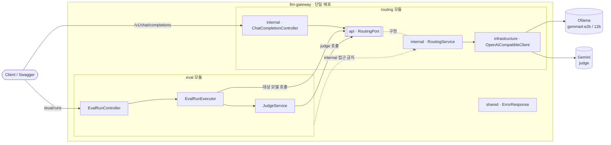
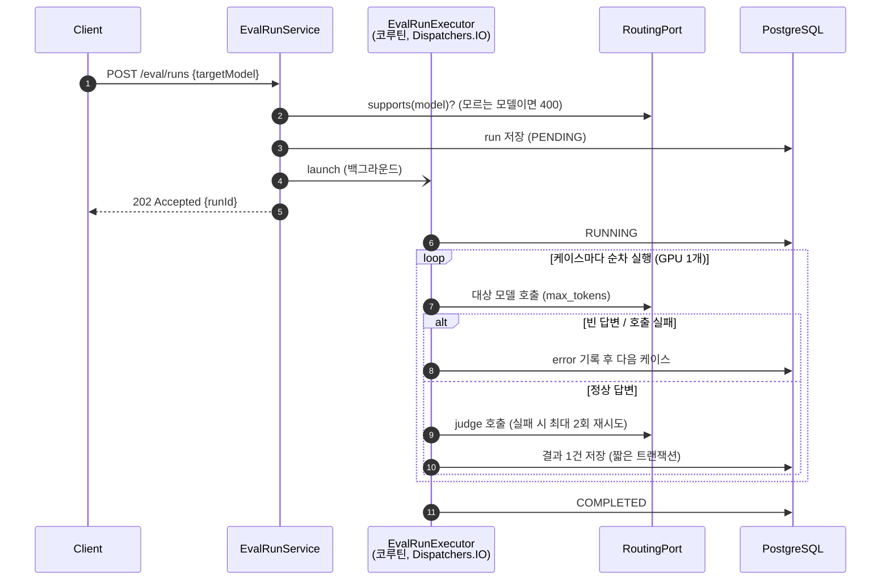
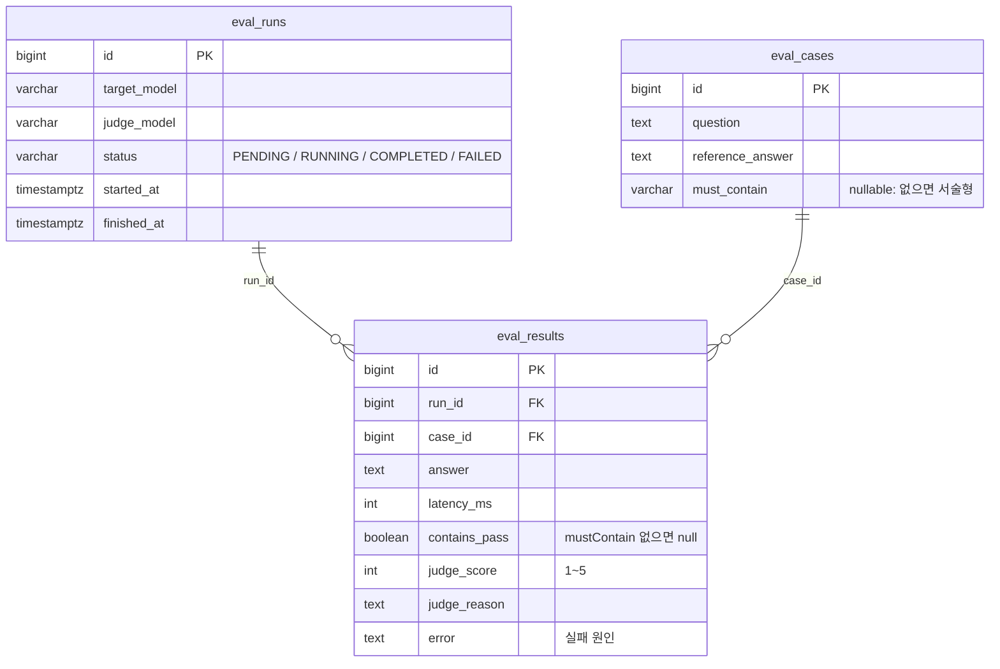
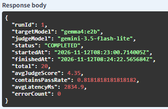
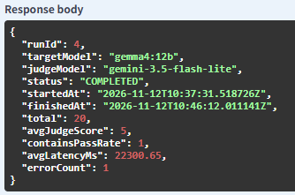

# llm-gateway
llm-gateway는 어떤 모델로 라우팅할지를 평가 결과로 정하는 **평가 기반 LLM 게이트웨이**입니다.

## 요약
- OpenAI 엔드포인트 호환: `/v1/chat/completions` -> 모델명으로 **Ollama**, **Gemini** 라우팅
- **POST** `/eval/runs`: 시드 케이스를 대상 모델에 돌리고 필수 키워드 체크 + LLM judge로 채점
- 평가 또한 외부 클라이언트와 같은 RoutingPort를 통과합니다.

### 기술 스택
Kotlin 2.3, Spring Boot 4.1, JPA, PostgreSQL 17, Flyway, Coroutines, Spring Modulith, Testcontainers

## 설계 결정
### 모듈 구조: 모듈러 모놀리식 + Spring Modulith

- 하나의 애플리케이션으로 배포하되, 모듈 간에는 공개된 `api` 패키지로만 의존합니다. 모듈 경계는 Spring Modulith의 `ModularityTests`가 빌드마다 검증합니다.

### 평가 실행 흐름


### 데이터 모델

- DB에는 FK와 `UNIQUE(run_id, case_id)` 제약을 두지만, `EvalResult` 엔티티는 `@ManyToOne` 없이 ID 컬럼만 가집니다. 조회 경로가 run의 결과 + 세부 케이스뿐이라 단순화했습니다.
- 실패한 케이스도 결과 행을 남기고 `error`에 원인을 기록합니다.


## 결과: gemma4:e2b vs gemma4:12b
측정 환경: 시드 20문항([문제 상세](src/main/resources/db/migration/V2__seed_eval_cases.sql)), judge 모델: `gemini-3.5-flash-lite`, GPU: RTX 4070 Ti 12GB

| 지표                             | gemma4:e2b | gemma4:12b |
|--------------------------------|---:|-----------:|
| 평균 judge 점수 (1~5) | 4.35 |        5.0 |
| 키워드 통과율      | 81.8% |       100% |
| 평균 지연                          | 2.8s |      22.3s |
| 에러                             | 0 / 20 |     1 / 20 |
| run 소요 시간                      | 약 1분 20초 |   약 8분 40초 |

| gemma4:e2b (run 1) | gemma4:12b (run 4) |
|---|---|
|  |  |    

- 12b 모델의 평균 judge 점수, 키워드 통과율은 에러 1건을 제외한 채점된 19건 기준
- 키워드 통과율: mustContain이 있는 문제 11건 기준
- 12b의 에러 1건은 대상 모델을 temperature=0.0으로 호출해서 reasoning이 반복되다가 애플리케이션에서 설정한 max_tokens(4096)에 걸려 발생.

결론: 두 모델의 품질 차이는 0.65점인데 비해 지연 시간은 약 8배 차이. e2b 모델은 한국어 문화, 높임말 표현 이해에서 낮은 점수를 기록함(예. case11 사자성어 '어부지리'의 뜻을 설명하는 문제에서 e2b:1점/12b:5점). 기본 라우팅은 e2b, 정확도가 중요한 요청은 12b, 한국 문화나 한국어 표현에 대한 질문도 12b를 선택하는 것이 좋음. 


## 실행 방법
1. 로컬 PC에 Ollama 설치가 필요합니다.
    [https://ollama.com/download](https://ollama.com/download)

2. postgres 17 컨테이너를 띄우고 gemma4 모델을 받습니다.
    ```shell
    docker compose up -d
    ollama pull gemma4:e2b
    ollama pull gemma4:12b
    ```

3. 애플리케이션 환경변수를 설정합니다.
    ```shell
    export GEMINI_API_KEY=YOUR_KEY #bash
    $env:GEMINI_API_KEY="YOUR_KEY" #PowerShell
    ```

4. 애플리케이션을 실행하고 API 요청을 보냅니다(Swagger UI 지원)
    ```shell
    ./gradlew bootRun
    ```
    Swagger UI: [http://localhost:8000/swagger-ui/index.html#/eval-run-controller](http://localhost:8000/swagger-ui/index.html#/eval-run-controller)
    ```http
    POST /eval/runs {"targetModel": "gemma4:e2b"}
    GET /eval/runs/{id} # 결과 요약
    GET /eval/runs/{id}/results # 케이스별 세부정보
    ```
    - POST /eval/runs 요청시 runId는 즉시 반환되고 시드 20문제의 풀이와 채점결과는 백그라운드로 진행되어 완료까지 e2b: 약 1분 20초, 12b: 약 8분 40초 소요됩니다.(RTX 4070 Ti 12GB 기준, GPU 사양 별 상이)

## 테스트
```shell
./gradlew test   # Testcontainers 사용: Docker 필요
```

| 테스트 | 검증 내용                                                 |
|---|-------------------------------------------------------|
| `EvalRunExecutorTest` | 케이스 실패 격리, 빈 답변은 judge 생략, judge 파싱 실패 시 재시도 포함 3회 호출 |
| `EvalRunQueryServiceTest` | 결과와 케이스를 `caseId`로 매칭, 없는 run은 `RUN_NOT_FOUND`        |
| `EvalRunSummaryTest` | 미채점 케이스는 평균에서 제외, 전부 에러일 때 null 집계                    |
| `EvalRunControllerTest` | 202 / 400 / 404 응답과 에러 코드                             |
| `JudgeResponseParserTest` | 코드블럭, 앞뒤 설명문, 깨진 JSON, 점수 범위                          |
| `RoutingServiceTest`, `ProviderClientsTest` | 모델명으로 프로바이더 선택, 미지원 모델 처리                             |
| `OpenAiCompatibleClientTest` | 응답 파싱, 5xx 변환, 모델명 덮어쓰기 없음                            |
| `ModularityTests` | 모듈 경계 위반 검증                                           |

---

## 한계
- judge가 Gemini 하나뿐이라 편향 가능성이 존재.
- 12b가 만점이라 시드 문제 난이도의 상향이 필요할 수 있음
- 시드 문제 20건은 통계적으로 유의미하다고 보기 어려움
- 첫 호출 전 모델의 웜업이 필요
- judge retry delay가 하드코딩됨(2s)
- temperature 0.0으로 고정: 샘플링에 따른 편차는 측정하지 않음
- run이 RUNNING 상태일 때 애플리케이션이 재시작되면 그대로 RUNNING으로 남음(복구 로직 없음).